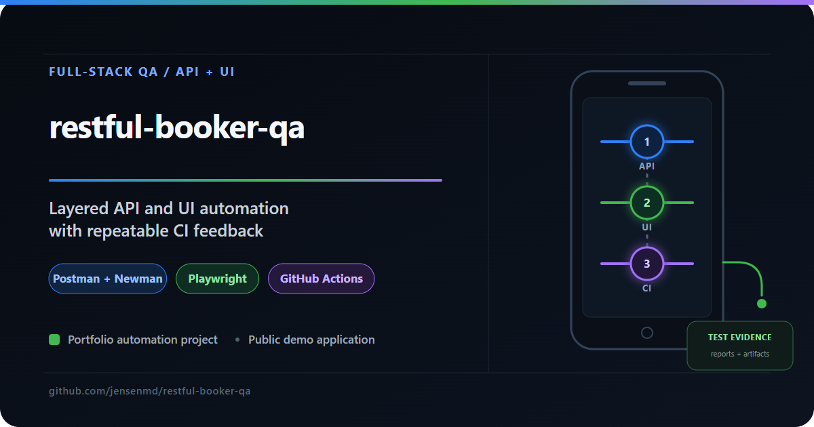

# restful-booker-qa

Booking quality depends on both the API behavior and the experience a user sees. This project tests those layers with Postman/Newman and Playwright against public booking demo targets, with separate GitHub Actions jobs and test reports.




Built by **Michael D. Jensen** — Senior QA Engineer with 15+ years of enterprise testing experience, specializing in API testing, automation, and CI/CD-integrated quality practices.

🔗 [LinkedIn](https://www.linkedin.com/in/michaeljensen-qa/) | 📧 jensen.md@gmail.com

---

## What This Project Demonstrates

| Layer | Stack | Coverage |
|---|---|---|
| API Testing | Postman + Newman | Auth flows, full CRUD, error handling, edge cases |
| UI Automation | Playwright + JavaScript | End-to-end booking workflows, form validation, cross-browser |
| CI/CD Pipeline | GitHub Actions | Both suites run automatically on every push and PR |

The API and browser suites provide complementary evidence. Separate CI jobs and reports make it easier to see which layer failed and investigate the result.

---

## Test Targets

- **API:** [Restful-Booker](https://restful-booker.herokuapp.com), with `/booking` and `/auth` endpoints for CRUD and authentication checks.
- **Browser:** [Restful-Booker Platform](https://automationintesting.online), with booking and contact workflows.

These are separate public demo targets. The suites exercise complementary layers; they do not verify one shared booking across the API and browser targets.

---

## Project Structure

```
restful-booker-qa/
├── .github/
│   └── workflows/
│       └── ci.yml              # Runs Newman + Playwright on push/PR
├── postman/
│   ├── restful-booker.collection.json   # Postman collection (importable)
│   ├── restful-booker.environment.json  # Environment variables
│   └── README.md               # Collection notes and Newman usage
├── playwright/
│   ├── tests/                  # Test specs
│   ├── pages/                  # Page Object Models
│   ├── utils/                  # Helpers and fixtures
│   ├── playwright.config.js
│   └── package.json
└── README.md
```

---

## Test Coverage

### API Layer — Postman / Newman

| Endpoint | Scenarios Covered |
|---|---|
| `POST /auth` | Token generation (valid credentials), rejection (invalid credentials) |
| `GET /booking` | List all bookings, filter by name, filter by date range |
| `POST /booking` | Create booking (valid payload, missing required fields, invalid dates) |
| `GET /booking/:id` | Retrieve specific booking by ID |
| `PUT /booking/:id` | Full update (authenticated) |
| `PATCH /booking/:id` | Partial update (authenticated) |
| `DELETE /booking/:id` | Delete booking (authenticated), verify removal |

JavaScript test scripts validate status codes, response schema, and business rules inline within each request.

### UI Layer — Playwright

| Workflow | Coverage |
|---|---|
| Room search | Search for available rooms by date |
| Booking happy path | Complete a full reservation end-to-end |
| Form validation | Required field enforcement, date conflict handling |
| Contact form | Submission and confirmation |

UI tests run cross-browser across **Chromium** and **Firefox** via Playwright's multi-browser configuration.

### Page Object Model

UI tests use the Page Object Model (POM) pattern — UI interactions are abstracted into reusable page classes rather than scattered across test specs. This keeps tests readable, maintainable, and resilient to UI changes.

---

## CI/CD Pipeline

GitHub Actions runs on every push and pull request to `main`:

- **Newman job** — executes the full Postman collection, uploads HTML report as a downloadable artifact
- **Playwright job** — runs all UI specs across Chromium and Firefox, uploads Playwright HTML report

Both jobs run independently and in parallel. A failure in one does not block the other.

> **CI triage:** These suites depend on shared public demo services. Investigate the response, trace, and test report before attributing a failure to the service, the test, or the application behavior.

---

## Running Locally

### Prerequisites
- Node.js v18+
- Newman and HTML reporter: `npm install -g newman newman-reporter-htmlextra`
- Playwright: installed via `npm install` in `/playwright`

### API Tests (Newman)
```bash
cd postman

newman run restful-booker.collection.json \
  --environment restful-booker.environment.json \
  --reporters cli,htmlextra \
  --reporter-htmlextra-export reports/api-report.html
```

### UI Tests (Playwright)
```bash
cd playwright
npm install
npx playwright install --with-deps

# Run all tests (headless)
npx playwright test

# Run with browser visible
npx playwright test --headed

# View HTML report
npx playwright show-report
```

---

## QA Portfolio Quick Reference

See [Michael D. Jensen’s QA portfolio](https://github.com/jensenmd) for the complete project overview.

| Project | Purpose and Approach |
| --- | --- |
| [fhir-api-qa](https://github.com/jensenmd/fhir-api-qa) | Checks whether a healthcare API preserves Patient data through its lifecycle, with isolated FHIR tests and useful CI failure evidence. |
| [pharmacy-spend-etl-qa](https://github.com/jensenmd/pharmacy-spend-etl-qa) | Checks that pharmacy spend data survives the trip from source files to analytics tables, using SQL reconciliation on a synthetic pipeline. |
| [restful-booker-qa](https://github.com/jensenmd/restful-booker-qa) **(this repository)** | Tests booking behavior at both API and browser layers, combining Postman/Newman and Playwright for repeatable regression feedback. |
| [qa-automation-showcase](https://github.com/jensenmd/qa-automation-showcase) | Examines API behavior and the quality of returned data together, using pytest, Postman, and Python validation. |
| [android-appium-wdio-poc](https://github.com/jensenmd/android-appium-wdio-poc) | Builds a focused baseline for Android UI checks, exercising Settings navigation on a local emulator with Appium and WebdriverIO. |
| [mapmyrun-quality-investigation](https://github.com/jensenmd/mapmyrun-quality-investigation) | Investigates how workout tracking affects data integrity and user trust, using mobile field experiments and separating observations from explanations. |
| [ai-qa-framework](https://github.com/jensenmd/ai-qa-framework) | Explores how AI can help develop useful API test coverage while keeping a QA engineer responsible for review and pytest execution. |
| [claude-code-qa-sessions](https://github.com/jensenmd/claude-code-qa-sessions) | Shows how human QA judgment guides Claude Code from finding coverage gaps to making targeted, reviewed test improvements. |
| [agentqa-orchestrator](https://github.com/jensenmd/agentqa-orchestrator) | Explores inspectable AI code reviews, using Gemini and Pydantic-defined response schemas to produce structured JSON audit artifacts. |

---

## Author

**Michael D. Jensen** — Senior QA Engineer
15+ years of enterprise software testing experience across healthcare IT, financial systems, telecommunications, and cybersecurity. Deep background in REST API validation, ETL pipeline testing, SQL-based data integrity verification, and full-stack manual testing in Agile environments.

Current hands-on work includes Python/pytest automation, Playwright UI testing, and CI/CD-integrated quality practices.

🔗 [LinkedIn](https://www.linkedin.com/in/michaeljensen-qa/) | 🐙 [GitHub Profile](https://github.com/jensenmd) | 📧 jensen.md@gmail.com
